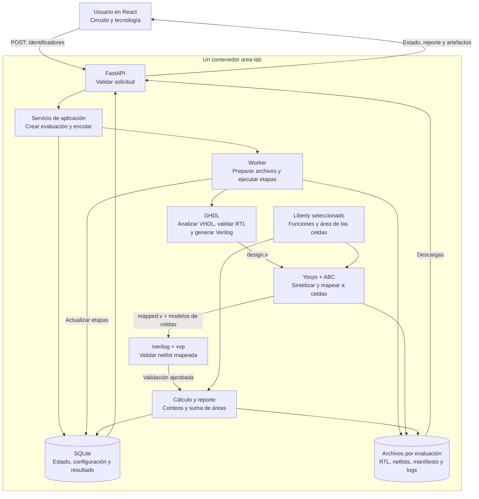

# Pipeline paso a paso: del VHDL al reporte de área

Complemento visual: [diagramas interactivos del pipeline](diagramas/index.html),
con grafos de arquitectura, recorrido de evaluación y comandos, además de SVG/PNG.

Este documento explica el flujo implementado en **ASIC Area Lab**: dónde se
seleccionan el circuito, el formato numérico y la tecnología, cómo se conectan
los componentes de software y qué hace cada herramienta EDA.

**Alcance:** calcular el área de las celdas del circuito existente. Se excluyen
el área de conexiones, placement, routing, clock tree, pads, floorplan y die.
Las conexiones lógicas sí permanecen en la netlist para conservar la función
del circuito y permitir su simulación.

**Estado actual:** se pueden seleccionar las once DPU registradas y las tres
bibliotecas typical: IHP130, Nangate45 y Nangate15. Los comandos de este
documento usan INT8/16 como ejemplo; el programa sustituye top, biblioteca,
fuentes y anchos según el perfil seleccionado. El detalle está en
[DPU_FORMATOS.md](DPU_FORMATOS.md). Las TCU todavía requieren adaptación.

## Decisiones y lugar donde se toman

| Decisión | Dónde se define | Estado actual |
|---|---|---|
| Circuito | Catálogo del backend: `design_id`, fuentes y top | Once DPU con wrapper registrado |
| Formato numérico | Asociado al RTL del diseño | INT, FXP, FP, Posit o LNS, según el perfil |
| Inclusión del wrapper | Frontera definida por el top | Incluido |
| Tecnología | Selección del usuario en React | IHP 130 nm, Nangate 45 nm o Nangate 15 nm |
| Archivo Liberty | Catálogo asociado a `technology_id` | Un `.lib` por tecnología |
| Corner, voltaje y temperatura | Configuración de la biblioteca | Typical con condiciones nominales fijas |
| Almacenamiento | Política de síntesis | Registros y lógica; sin SRAM |
| Optimización | Script de Yosys | Misma secuencia para las tres tecnologías |
| Frecuencia objetivo | Configuración de síntesis | No se impone en este piloto |
| Referencia y estímulos | Adaptador de validación | 256 vectores deterministas |
| Límites de ejecución | Variables de entorno y Compose | Tiempo, cola y recursos |

## Diagrama de conexiones



React se ejecuta en el navegador. El contenedor sirve sus archivos compilados
y contiene el backend, SQLite y los ejecutables EDA. Las flechas de herramientas
representan llamadas a procesos y archivos, no servicios HTTP independientes.

## 1. Registrar el circuito disponible

El backend mantiene el catálogo en
[catalog.py](../backend/src/area_lab/infrastructure/catalog.py). Cada diseño
incluye identificador, formato, top, archivos VHDL, wrapper y características
que deben conservarse.

Para `int8_16`, las fuentes son:

```text
INT8_Mult.vhd
INT8_Adder.vhd
INT8_DPU.vhd
INT8_16_DPU_perf_top.vhd
```

El top seleccionado es **`INT8_16_DPU_perf_top`**. El top es una entidad del
diseño, no simplemente el nombre de un archivo. Define la frontera de medición:
se incluye el hardware que cuelga de esa entidad y permanece tras la síntesis.

El circuito medido contiene:

```text
80 bits de registros de entrada → DPU combinacional → 16 bits de registro de salida
```

Por tanto, se esperan **96 flip-flops**, además de la lógica aritmética.
Seleccionar directamente `dot_unit_coreINT8` mediría la DPU combinacional sin
los registros del wrapper y constituiría otra frontera de medición.

El selector de diseño permite elegir las once DPU revisadas. No hay carga
libre de archivos VHDL desde la UI. Los perfiles están en
[designs.py](../backend/src/area_lab/infrastructure/designs.py).

## 2. Asociar el formato numérico al RTL

Seleccionar `int8_16` identifica un circuito con ocho operandos de 8 bits,
un acumulador de 16 bits y una salida de 16 bits, con aritmética entera firmada.

La operación es:

```text
R = A0×B0 + A1×B1 + A2×B2 + A3×B3 + C0
```

El resultado conserva los 16 bits inferiores. Cuando hay overflow, se aplica
el comportamiento modular del circuito; no saturación.

GHDL y Yosys reciben los anchos y operaciones ya descritos en el VHDL. Para
medir FP16, por ejemplo, hay que seleccionar sus fuentes y top existentes,
y utilizar una referencia de validación adecuada para FP16. No basta con
cambiar el nombre de una opción después de sintetizar INT8.

En una **TCU con selección dinámica**, el formato ejecutado es una entrada de
funcionamiento. Cambiar esa entrada no cambia el área del hardware instalado.
Medir la TCU completa conserva las rutas que su RTL permite seleccionar.
Especializarla fijando selectores como constantes puede eliminar hardware y
debe identificarse como una variante distinta del diseño original.

## 3. Seleccionar la tecnología en el frontend

React consulta el catálogo mediante:

```http
GET /api/v1/catalog
```

El backend devuelve diseños y tecnologías. El frontend muestra las opciones y
permite elegir una biblioteca disponible.

| ID | Biblioteca | Condición inicial |
|---|---|---|
| `ihp130` | IHP SG13G2 130 nm | Typical, 1,20 V, 25 °C |
| `nangate15` | Nangate FreePDK15 | Typical NLDM, 0,80 V, 25 °C |
| `nangate45` | Nangate / FreePDK45 | Typical NLDM, 1,10 V, 25 °C |

Corner, voltaje y temperatura están asociados a la biblioteca seleccionada.
No hay selectores independientes para modificarlos. Son metadatos configurados
en el catálogo; deben verificarse al incorporar una biblioteca nueva.

Las rutas del ejemplo son:

```text
ihp130    → assets/libraries/ihp130/cells.lib
nangate15 → assets/libraries/nangate15/cells.lib
nangate45 → assets/libraries/nangate45/cells.lib
```

El frontend envía un identificador conocido y el backend resuelve la ruta.
No se aceptan rutas arbitrarias ni comandos de síntesis desde la UI.

## 4. Enviar la solicitud a FastAPI

Al pulsar **Calcular área**, React envía:

```http
POST /api/v1/experiments
Content-Type: application/json
```

```json
{
  "design_id": "int8_16",
  "technology_id": "ihp130"
}
```

Los archivos RTL y Liberty ya están dentro del contenedor. La solicitud
contiene las elecciones para esta evaluación.

FastAPI/Pydantic valida la estructura del cuerpo. El servicio comprueba que
existan diseño y tecnología, que la biblioteca esté disponible y que la cola
tenga capacidad.

Si falta el Liberty de la tecnología seleccionada, se rechaza la solicitud antes de ejecutar las
herramientas. Una solicitud válida recibe **HTTP 202** y un ID: el trabajo fue
aceptado, pero todavía no existe un resultado de área.

Los contratos están en [schemas.py](../backend/src/area_lab/api/schemas.py)
y las rutas en [routes.py](../backend/src/area_lab/api/routes.py).

## 5. Guardar la evaluación y colocarla en la cola

[ExperimentService](../backend/src/area_lab/application/services.py) crea una
evaluación con ID, diseño, tecnología, fecha y estado inicial `queued`.
La guarda en SQLite y coloca el ID en una cola de memoria.

Existe un worker de síntesis. Ejecuta una evaluación mientras otras esperan.
La cola permite que la API siga respondiendo durante las operaciones EDA.
Este ejemplo no necesita Redis, Celery ni otro servidor de colas.

La capacidad configurada de cuatro corresponde a **cuatro evaluaciones
esperando**, además de la que ya esté en ejecución. Si la cola está llena,
se devuelve HTTP 429.

## 6. Preparar una ejecución independiente

El worker cambia el estado a `running` y prepara:

```text
/app/data/runs/<id-de-evaluacion>/
```

Allí copia las fuentes VHDL del perfil bajo `sources/rtl/<design_id>/`,
preservando sus subcarpetas, y el Liberty elegido. La copia tecnológica
recibe el nombre local `cells.lib`: el nombre es común para simplificar el
script, pero los bytes corresponden a la tecnología seleccionada.

Se genera `manifest.json` con top, formato, tecnología, condiciones nominales,
hashes SHA-256 de fuentes y Liberty, versiones de herramientas, política de
síntesis, almacenamiento y alcance.

El snapshot de assets también registra la procedencia y el commit del
repositorio. Los hashes identifican los bytes utilizados incluso si había
cambios locales respecto a ese commit.

Cada ejecución trabaja sobre sus propias copias. El RTL y las bibliotecas
originales no se editan para obtener la medición.

## 7. Analizar VHDL y resolver sus bibliotecas con GHDL

Dos clases de biblioteca participan en el flujo:

| Biblioteca | Contenido y uso |
|---|---|
| VHDL, como `int8_16_lib` | Entidades, arquitecturas y paquetes; GHDL resuelve el diseño |
| Liberty, como `cells.lib` | Celdas tecnológicas, funciones, pines y áreas; Yosys realiza el mapeo |

GHDL analiza primero los módulos aritméticos y la DPU:

```bash
ghdl -a --std=08 -fsynopsys -fexplicit \
  --work=int8_16_lib \
  sources/rtl/int8_16/needed_flopoco_files/INT8_Mult.vhd \
  sources/rtl/int8_16/needed_flopoco_files/INT8_Adder.vhd \
  sources/rtl/int8_16/INT8_DPU.vhd
```

Después analiza el wrapper en la biblioteca VHDL `work`:

```bash
ghdl -a --std=08 -fsynopsys -fexplicit \
  sources/rtl/int8_16/INT8_16_DPU_perf_top.vhd
```

Las dependencias se colocan antes de los bloques que las utilizan.
`--std=08` selecciona VHDL-2008; las opciones de compatibilidad permiten
analizar el código FloPoCo y sus paquetes existentes.

Posit16 y Posit32 requieren una preparación adicional: `ghdl --chop` separa
sus unidades y se compilan una sola vez los helpers repetidos que sean
idénticos byte a byte. Las unidades diferentes con el mismo nombre se rechazan.
Esto resuelve los símbolos duplicados del enlace LLVM sin modificar el RTL.
El procedimiento y sus hashes están en el manifiesto; véase
[vhdl.py](../backend/src/area_lab/infrastructure/vhdl.py).

El backend LLVM de GHDL suministrado también necesita el compilador C `cc`,
el linker y los archivos de desarrollo de zlib para resolver `-lz`.
El Dockerfile usa Debian Trixie (glibc 2.41) porque el runtime GHDL fijado
requiere glibc ≥2.38, e instala `build-essential` y `zlib1g-dev`. Ejecuta
[check_toolchain.py](../scripts/check_toolchain.py) durante la construcción
para comprobar análisis, elaboración/enlace, simulación y síntesis antes
de iniciar el servicio. `ghdl --version` por sí solo no valida esas dependencias.

## 8. Validar funcionalmente el RTL

El backend genera 256 estímulos deterministas por diseño con semilla `20261005`,
con casos dirigidos de su familia y palabras aleatorias del ancho correcto.
GHDL simula el wrapper original, espera dos flancos por estímulo y escribe
`rtl-results.txt`. Se rechazan resultados incompletos o indefinidos.

Para INT8/16 e INT16/32, Python exige además que cada resultado coincida con:

```python
resultado = (
    sum(a * b for a, b in zip(operandos_a, operandos_b)) + acumulador
) & ((1 << bits_resultado) - 1)
```

Los operandos de esa referencia se interpretan con signo. Para FXP, FP, Posit
y LNS, el oráculo es el RTL original: se comprueba preservación durante la
síntesis, no precisión numérica independiente. No se usan tolerancias para
ocultar diferencias. El reporte identifica la referencia utilizada.

Se genera `vectors.txt` con las entradas y resultados RTL esperados para la
posterior comparación con la netlist mapeada. La generación de estímulos y los
testbenches están en [validation.py](../backend/src/area_lab/infrastructure/validation.py).

## 9. Generar Verilog sintetizable con GHDL

El comando utilizado es:

```bash
ghdl --synth --std=08 -fsynopsys -fexplicit \
  --out=verilog INT8_16_DPU_perf_top
```

La salida se guarda como `design.v`. GHDL elabora para síntesis la jerarquía
seleccionada y genera su representación Verilog. Ese archivo todavía debe
pasar por optimización y mapeo tecnológico.

El ejemplo ejecuta GHDL y Yosys por separado. Existe una ruta alternativa
mediante el plugin GHDL–Yosys, pero no es la utilizada aquí.

Fuente: [documentación de síntesis de GHDL](https://ghdl.github.io/ghdl/using/Synthesis.html).

## 10. Preparar la lógica genérica con Yosys

El backend genera `synth.ys`. Su inicio es:

```tcl
read_liberty -lib cells.lib
read_verilog design.v
hierarchy -check -top INT8_16_DPU_perf_top
synth -top INT8_16_DPU_perf_top -flatten -noabc
```

| Instrucción | Función dentro del ejemplo |
|---|---|
| `read_liberty -lib` | Importar interfaces de las celdas disponibles |
| `read_verilog` | Leer la salida de GHDL |
| `hierarchy -check` | Comprobar la jerarquía desde el top |
| `synth` | Transformar y optimizar la representación del circuito |
| `-flatten` | Integrar la jerarquía en un módulo para esta medición |
| `-noabc` | Reservar el mapeo con ABC para la etapa explícita siguiente |

La elección tecnológica ya está disponible como entrada, pero el mapeo
efectivo a sus celdas se realiza en la etapa 12.

## 11. Resolver el almacenamiento durante la síntesis

La política de este piloto está fijada: los registros del wrapper se mapean
a FF y las tablas constantes del multiplicador siguen la ruta de lógica
combinacional. No se instancian macros SRAM.

No hay un selector SRAM/FF en la interfaz. La síntesis genérica puede bajar
memorias a lógica/registros, por lo que una integración futura de macros
debe resolverse **antes de esa conversión**.

Para utilizar SRAM en una TCU hay que proporcionar una macro compatible,
modelos funcionales y de área, y reglas de mapeo. Deben conservarse los puertos,
reset, latencia y comportamiento del almacenamiento original. Una biblioteca
de puertas estándar no incorpora automáticamente una SRAM adecuada.

Cambiar el circuito para acomodar una macro constituye una modificación
arquitectónica y debe distinguirse de medir el RTL existente.

## 12. Aplicar el mapeo tecnológico

Las instrucciones son:

```tcl
dfflibmap -liberty cells.lib
abc -liberty cells.lib
```

`dfflibmap` mapea los flip-flops y `abc` mapea la lógica combinacional a las
celdas descritas por el Liberty.

Un registro lógico puede utilizar una celda IHP en una ejecución y una celda
Nangate en otra. También pueden cambiar la selección y cantidad de puertas,
multiplexores y funciones combinadas.

La biblioteca se eligió al crear la evaluación y Yosys la leyó al iniciar el
script. En estos comandos se aplica efectivamente al mapeo.

Para comparar tecnologías se repite la síntesis del mismo diseño con otra
biblioteca. No se escala un área anterior mediante una proporción de nanómetros.
Se conserva la misma política de síntesis y se registra el corner de cada caso.
El piloto no impone un objetivo temporal ni garantiza un óptimo global de área.

Fuente: [mapeo a bibliotecas de Yosys](https://yosyshq.readthedocs.io/projects/yosys/en/v0.56/using_yosys/synthesis/cell_libs.html).

## 13. Comprobar que el mapeo esté completo

Después del mapeo se ejecuta:

```tcl
delete t:$scopeinfo
clean
check -assert
write_json mapped.json
write_verilog -noattr mapped.v
tee -o stat.json stat -liberty cells.lib -json
```

`$scopeinfo` es información de Yosys sobre el diseño y se elimina del conteo
de hardware. No se eliminan operadores hardware desconocidos para forzar
un reporte válido.

Además de `check -assert`, el backend comprueba que exista el top, no queden
memorias sin mapear, todos los tipos de celda utilizados tengan área en el
Liberty y el circuito no esté vacío. Una celda genérica o referencia sin
resolver invalida el reporte.

Se rechazan latches y macros inesperados. Se comprueba el estado según el
perfil: INT8 conserva 96 FF e INT16 conserva 192. En otras familias se permite
la eliminación legítima de bits no observables, dentro del límite declarado
por su wrapper; el conteo publicado es el real. Las TCU requieren otros controles.

## 14. Validar la netlist mapeada

Yosys genera modelos funcionales Verilog de las celdas a partir del mismo
Liberty. Iverilog compila esos modelos, `mapped.v` y el testbench Verilog.
Vvp ejecuta la simulación y se comparan los mismos 256 vectores con la referencia.

Esta etapa comprueba que la implementación mapeada produce los resultados
esperados para esas pruebas. Una incompatibilidad o diferencia de salida
termina la evaluación sin un área publicada como válida.

La simulación es funcional: el reloj de los testbenches organiza estímulos,
pero **no demuestra una frecuencia ASIC alcanzable**. No se aplican retardos
físicos ni se ejecuta STA. Tampoco se ejecuta equivalencia formal en este piloto.

## 15. Contar celdas y calcular su área

El backend cruza dos entradas:

```text
mapped.json → cantidad de instancias por tipo de celda
cells.lib   → área y categoría de cada tipo
```

La fórmula es:

```text
Área total = Σ (cantidad de instancias del tipo i × área de una celda del tipo i)
```

El desglose distingue lógica combinacional, flip-flops, latches y macros si
existieran. La clasificación secuencial utiliza los grupos `ff` y `latch`
del Liberty; no depende únicamente del nombre comercial de la celda.
La suma se calcula con Decimal y se contrasta con `stat -liberty`.
Si los resultados no coinciden, se rechaza la evaluación.

Las unidades físicas deben estar respaldadas por la biblioteca. En este
ejemplo se utiliza su convención de µm² y se registra esa procedencia.
Liberty no impone por sí solo una unidad física universal de área.

Las conexiones permanecen en la netlist para describir qué celdas se conectan
y permitir la simulación. Su área de cableado no se suma y no se realiza routing.

Implementación: [liberty.py](../backend/src/area_lab/infrastructure/liberty.py).
Fuente: [estadísticas de Yosys](https://yosyshq.readthedocs.io/projects/yosys/en/v0.50/cmd/stat.html).

## 16. Generar artefactos y guardar el resultado

| Archivo | Contenido |
|---|---|
| `manifest.json` | Configuración, versiones y hashes |
| `design.v` | Salida Verilog de GHDL |
| `mapped.v` | Netlist de celdas tecnológicas |
| `mapped.json` | Representación utilizada para contar celdas |
| `stat.json` | Estadísticas de Yosys |
| `report.json` | Total, desglose y validaciones |
| `report.csv` | Cantidad y área por tipo de celda |
| `run.log` | Comandos, salidas, errores y duración |
| `yosys.log` | Registro de la síntesis Yosys, guardado por línea |
| `vectors.txt` | Estímulos y resultados esperados |
| Testbenches y scripts | Evidencia para revisar la ejecución |

Los archivos se guardan en la carpeta de la evaluación. SQLite guarda estado,
configuración y reporte en `/app/data/experiments.sqlite3`. El volumen Docker
`area-lab-data` conserva ese directorio al recrear el contenedor.

Los estados principales son:

```text
queued → running → succeeded
                 → failed
```

Las etapas internas permiten mostrar análisis, validación RTL, conversión,
mapeo, comprobaciones, validación de netlist y generación de reporte.

Si una herramienta o comprobación falla, se guarda el diagnóstico y no se
asigna un cero como si fuera un resultado de área. Al reiniciar el servicio,
los trabajos que quedaron pendientes o ejecutándose se marcan `interrupted`.
La cola es de memoria y no se reanuda automáticamente.

## 17. Consultar el progreso y mostrar los resultados

React consulta la API aproximadamente cada 1,5 segundos mientras hay
evaluaciones activas y cada 5 segundos cuando no las hay. No recibe datos
directamente de Yosys: FastAPI obtiene estado y reporte del repositorio.

La interfaz muestra área total, desglose, validaciones e historial. También
solicita las descargas CSV y ZIP a FastAPI.

La comparación permite elegir entre tecnologías para la DPU seleccionada o
formatos dentro de una biblioteca. Conserva la última evaluación válida por
caso y muestra el formato real en el historial. No mezcla DPU diferentes en
la comparación de tecnologías. Actualmente cada biblioteca tiene un único corner.

| Ruta | Uso |
|---|---|
| `GET /api/v1/catalog` | Opciones disponibles |
| `POST /api/v1/experiments` | Crear evaluación |
| `GET /api/v1/experiments` | Últimas 100 evaluaciones |
| `GET /api/v1/experiments/{id}` | Estado y reporte |
| `GET /api/v1/experiments/{id}/logs` | Últimos 100 KB del log |
| `GET /api/v1/experiments/{id}/artifacts` | ZIP de artefactos |
| `GET /api/v1/experiments/{id}/report.csv` | Desglose de celdas |

El ZIP contiene los artefactos seleccionados en el código. La biblioteca
Liberty original sigue disponible en los assets; no se incluye automáticamente
en la descarga ZIP.

## 18. Integraciones de software y arquitectura

| Componente | Se conecta con | Intercambio |
|---|---|---|
| React | FastAPI | HTTP/JSON |
| React Query | API del frontend | Caché, actualización y estados de solicitudes |
| Zod | Respuestas HTTP | Validación del contrato recibido |
| FastAPI/Pydantic | Servicio de aplicación | Solicitudes validadas |
| Servicio de aplicación | Repositorio | Evaluaciones y resultados |
| Servicio de aplicación | Cola/worker | IDs de trabajos pendientes |
| Adaptador de síntesis | Herramientas EDA | Argumentos de ejecución y archivos |
| GHDL | Fuentes y testbench VHDL | Análisis, simulación y Verilog |
| Yosys/ABC | Verilog y Liberty | Netlist mapeada y estadísticas |
| Iverilog/vvp | Netlist, modelos y vectores | Resultados de simulación |
| SQLite | Archivo persistente | Historial y estados |
| Volumen Docker | `/app/data` | Conservación de resultados |

Las capas del backend son:

```text
domain/          Entidades, errores y contratos de repositorio/síntesis
application/     Casos de uso y coordinación de evaluaciones
infrastructure/  Adaptadores SQLite, EDA, Liberty y configuración
api/             Rutas HTTP y contratos Pydantic
main.py          Composición e inyección de dependencias
```

El servicio depende de los contratos `ExperimentRepository` y
`SynthesisGateway`. SQLite y el adaptador EDA implementan esos contratos.
[main.py](../backend/src/area_lab/main.py) conecta las implementaciones al arrancar.

En despliegue, FastAPI sirve el frontend compilado. React se ejecuta en el
navegador y Vite participa en la construcción del frontend. GHDL, Yosys,
iverilog y vvp son procesos temporales que lanza el backend. SQLite está
embebido; no hay un servidor PostgreSQL ni otros servicios obligatorios.

Durante desarrollo local puede ejecutarse Vite en el puerto 5173. Su proxy
redirige `/api` a FastAPI en el puerto 8000. En el contenedor final ambos se
acceden mediante el servidor FastAPI del puerto 8000.

Los límites Compose controlan recursos del programa: 900 segundos **por
comando** de forma predeterminada, configurables con
`AREA_LAB_COMMAND_TIMEOUT_SECONDS` en `.env` o en el entorno; hasta 4 GB y
2 CPU, con un solo worker EDA. El timeout efectivo queda en `manifest.json`.
Los errores de herramientas incluyen un extracto de las últimas 40 líneas,
limitado a 8 KB, y los registros completos se conservan en el ZIP incluso si
la evaluación falla. La espera de apagado de
20 minutos no garantiza vaciar toda la cola; los trabajos inconclusos se
marcan interrumpidos al reiniciar. Son límites de ejecución, no parámetros
del ASIC. El límite anterior de 180 segundos se alcanzó en FXP16/32 con IHP130.

## Ampliación a octets y TCU

Las once DPU registradas ya tienen perfiles de fuentes, top, biblioteca, anchos
y validación. Para incorporar octets o TCU queda adaptar:

1. Perfiles con sus interfaces, generics, selectores y fuentes por biblioteca.
2. Testbenches con buffers, protocolo, reset y secuencias HMMA correspondientes.
3. Criterios de estado/memoria propios de cada jerarquía; no aplicar 96 FF.
4. Modelos y mapeo de macros si se decide usarlas, conservando la función RTL.
5. Presupuesto de ejecución y comparación por configuración, modo y política.

El alcance de las TCU se mantiene definido por sus tops existentes. La
ampliación adapta la medición y validación a esas jerarquías, preservando
arquitectura, interfaces, formatos soportados y comportamiento.

La implementación del procesamiento está en
[synthesis.py](../backend/src/area_lab/infrastructure/synthesis.py).
Los resultados reales del piloto y los límites de su verificación están
en [VALIDACION.md](VALIDACION.md).
